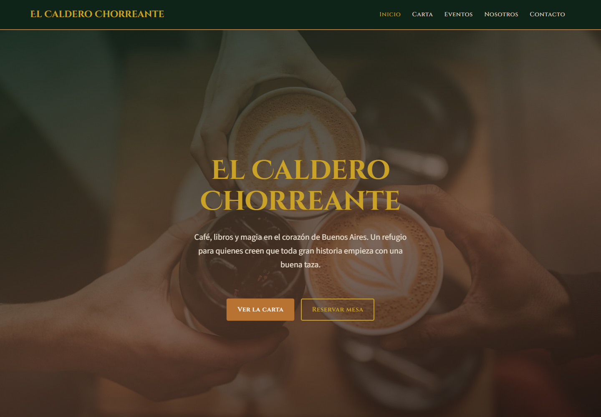
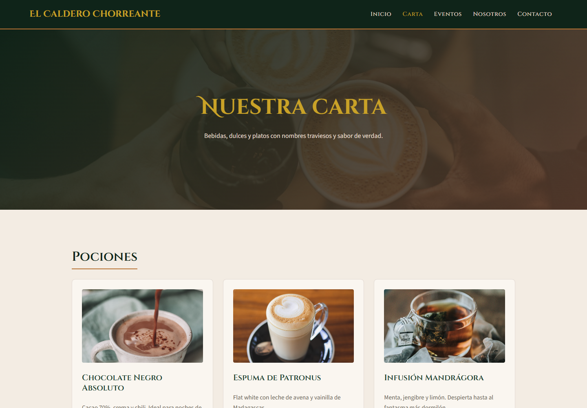
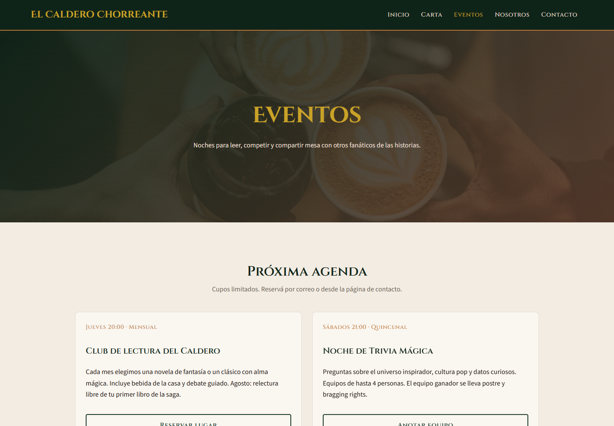
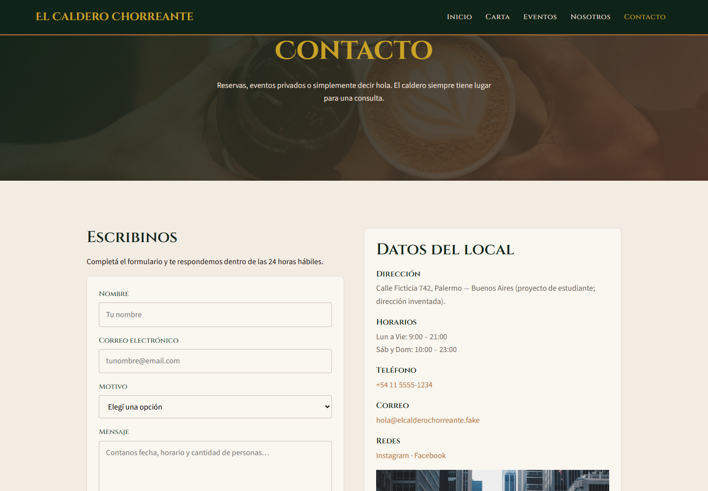

# El Caldero Chorreante

Sitio web estático de un **café-librería mágico ficticio** inspirado en el universo de Harry Potter. Proyecto final del curso de Desarrollo Web (Coderhouse).

## Sitio en producción

**Deploy (Vercel):** [https://desarrollo-web-flex-proyecto-final.vercel.app](https://desarrollo-web-flex-proyecto-final.vercel.app)

## Capturas

Inicio, carta, eventos y contacto.









## Páginas

| Archivo | Descripción |
|---------|-------------|
| `index.html` | Inicio — hero de marca y propuesta de valor |
| `pages/carta.html` | Carta de bebidas, dulces y platos |
| `pages/eventos.html` | Agenda de club de lectura, trivia y talleres |
| `pages/nosotros.html` | Historia, valores y equipo |
| `pages/contacto.html` | Formulario, horarios y datos del local |

## Estructura

```
mi-proyecto/
├── index.html
├── pages/
├── scss/           # Fuentes SCSS (partials + main.scss solo con @use)
├── styles/         # CSS compilado
├── assets/images/  # Multimedia
├── vercel.json     # Configuración de deploy en Vercel
└── README.md
```

## Autor

**Agustín Farber** — Proyecto final · Coderhouse · Desarrollo Web Flex
